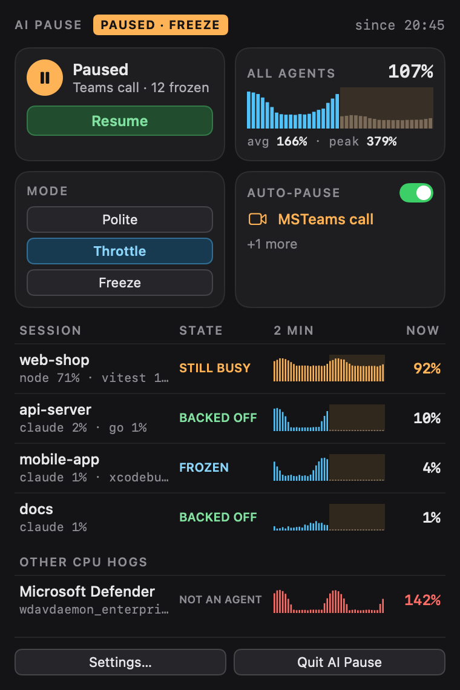
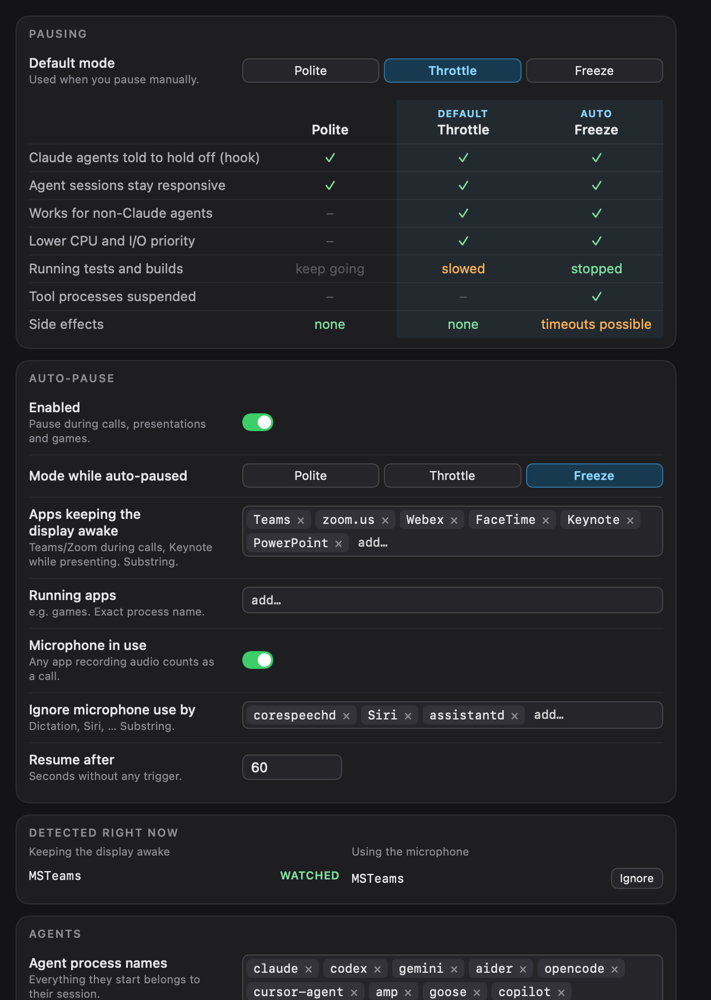

# AI Pause

A macOS menu bar app that tells AI coding agents (Claude Code, Codex, Gemini CLI, aider, …) to stop
CPU-heavy work while you present in a call or play a game. No more test suites spinning up or browser
windows popping open in the middle of a screen share.

<p align="center"></p>

- **Pauses automatically** during Teams/Zoom/Webex/FaceTime calls, Keynote/PowerPoint presentations, or while chosen apps (games) run.
- **CPU per agent session**: an agent plus everything it started, with a 2-minute chart.
- **Shows whether agents comply**: *backed off* or *still busy* after a pause starts.
- **Other CPU hogs**, such as Microsoft Defender (`wdavdaemon`), appear while they're busy.

## Install

```sh
brew install --cask philipparndt/ai-pause/ai-pause
ai-pause install-login          # start now and at every login
ai-pause install-claude-hook    # optional: Claude Code hook, see below
```

Requires macOS 14.2 or newer. To build from source: `make install` (needs Go and Xcode).

## Pause modes

| | Polite | Throttle | Freeze |
|---|:---:|:---:|:---:|
| Claude agents told to hold off (hook) | ✓ | ✓ | ✓ |
| Works for non-Claude agents | – | ✓ | ✓ |
| Lower CPU and I/O priority | – | ✓ | ✓ |
| Running tests and builds | keep going | slowed | stopped |

- **Polite**: the Claude Code hook refuses `Bash` and browser tools and tells the agent why. Read-only commands stay allowed.
- **Throttle**: agent process trees also run at background priority.
- **Freeze**: everything the agents started (tests, builds, browsers) is also stopped with `SIGSTOP` and continued on resume. The agents themselves keep running.

Quitting the app always releases every process it touched.

## Settings

Left-click the menu bar icon for the popover, right-click for a classic menu. *Settings…* covers the
modes, auto-pause triggers, watched processes and the Claude Code hook. Apps detected right now can be
added with one click.

<p align="center"></p>

## CLI

```
ai-pause pause [-mode M] [-for 1h] [-reason TEXT]
ai-pause resume | status | sessions | triggers
ai-pause check                  # exits 1 while paused
ai-pause wait && npm test       # waits until the pause is over
```

Agents without hooks can be asked to check first, e.g. in `AGENTS.md`:

> Before running tests or builds, run `ai-pause check`. If it fails, don't run them.

Config: `~/.config/ai-pause/config.json`.

## Development

```sh
make             # build for this Mac
make install     # → ~/Applications/AI Pause.app, starts at login
make screenshots # regenerate docs/*.png from docs/demo.json
make release-publish VERSION=x.y.z   # signed, notarized release + Homebrew tap
```

Go handles detection, sampling and pausing (`app/`), and the views are SwiftUI (`app/ui/`).

## License

[MIT](LICENSE)
